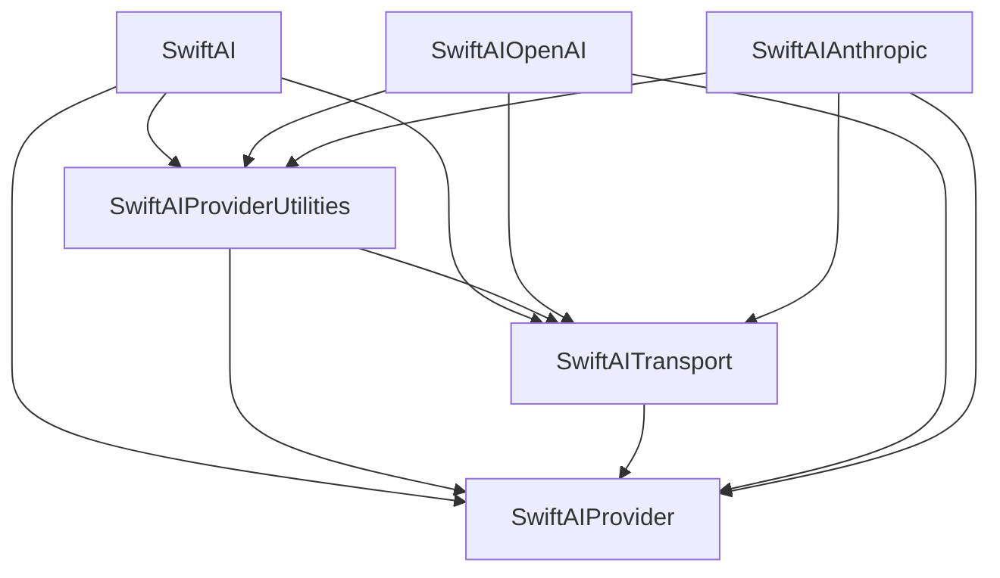

# SwiftAISDK Modular Package Migration Plan

Date: 2026-10-25

Status: Migration in progress. [M0 inventory](Migration/M0/README.md),
[M1 catalog/tooling](Migration/M1/README.md), and [M2 core extraction](Migration/M2/README.md)
are complete. [M3 provider pilot](Migration/M3/README.md) completed on 2026-10-25:
core, Anthropic, compatible and OpenAI are extracted local packages, consumed by
the compatibility aggregate. [M4 publication rehearsal](Migration/M4/README.md) is complete. [M5 organization and first modular releases](Migration/M5/README.md) is complete.
The canonical repository is transferred; core and the three pilot adapters are published at independent Swift version 1.0.0. [M6 extraction](Migration/M6/README.md) has moved all 52 package implementations and is completing final verification. M7 has not started.

SwiftAISDK will remain a Swift-native port of the provider-facing Vercel AI SDK.
The migration should let consumers select and update providers independently,
while reducing the repeated work of tracking upstream changes, adding providers,
maintaining documentation, and releasing packages.

The destination is the `SwiftAISDK` GitHub organization: one canonical
development monorepo and independently versioned distribution repositories.
Provider package boundaries should normally follow upstream npm packages. Shared
core modules will initially share one Swift package and release version. Swift
APIs, concurrency, networking, and platform behavior remain native.

This plan supplements [AgentPortingGuide.md](AgentPortingGuide.md). Existing
porting and release procedures remain in effect until their replacement passes
the corresponding migration gate. Work stays on the current branch by default;
commits and publication follow the user's requested scope.

## Acceptance criteria

- An external app can install one provider without compiling unrelated providers,
  MCP, or UI support.
- An app can combine independently released provider versions whose shared core
  requirements intersect. Conflicting requirements fail during resolution.
- Core generation works with a consumer-defined model without a built-in provider.
- A provider's upstream implementation, tests, recorded differences, and Swift
  release can be traced in both directions.
- Adding a provider requires one package registration plus its implementation,
  translated tests, and public usage guide. Package lists, CI matrices, manifests,
  release metadata, and documentation indexes are derived from that registration.
- A provider-only patch can be released without releasing unchanged providers or
  core. Shared changes select the affected dependency closure for verification.
- Every current provider, supported capability, platform guarantee, and known gap
  has an explicit destination. Extraction does not silently drop behavior or
  convert a missing port into an out-of-scope item.
- Published packages build outside the monorepo using ordinary SwiftPM Git
  dependencies. A successful local workspace build alone is insufficient.

## Current constraints

The inspected source baseline is `fc4e5dc`, tagged `2.8.1`. The package has one
runtime target, one library product, and one test target. Its 311 runtime Swift
files contain approximately 113,000 lines. The current minimum tools version is
Swift 6.3, with macOS 12 and iOS 15 deployment targets.

Several boundaries need explicit extraction:

| Current location | Required change |
| --- | --- |
| `Providers/ProviderRegistry.swift` | Move concrete provider factories to the provider that owns them. Keep registry abstractions independent of built-in providers. |
| `Providers/OpenAICompatibleProvider.swift` | Separate the generic compatible implementation from dispatch to OpenAI, xAI, Perplexity, Groq, DeepSeek, and other concrete implementations. |
| `Providers/CustomProvider.swift` | Separate explicit provider resolution from the implicit Gateway fallback. Preserve existing default behavior through the compatibility surface. |
| `Models/OpenAICompatibleConfig.swift` | Separate neutral settings and transport configuration from OpenAI and other provider-specific options. Do not publish the current mixed configuration wholesale. |
| `CoreProtocols.swift` and related result types | Extract complete protocol/type closures, including stream events and returned values, without creating a core-to-facade cycle. |
| `MCPClientActor.swift` | Account for its public `AITool` bridge when placing MCP and tool abstractions. |
| `Tests/SwiftAISDKTests` | Move fixtures and tests with their owning behavior; add external consumer checks because most current files use `@testable import`. |

Before M1, the version/inventory scripts parsed Markdown and the documentation
generator parsed the capability table. M1 switches these readers to structured
metadata and generates the old tables, retaining existing CLI flags. The catalog
now owns package registration; see [Porting/README.md](../Porting/README.md).

## GitHub organization and repository ownership

Use these names as the proposed public layout:

| Repository | Role |
| --- | --- |
| `SwiftAISDK/SwiftAISDK` | Transfer of the existing repository; canonical source, issues, tests, porting records, tooling, examples, and documentation. Its root package remains the compatibility entry point. |
| `SwiftAISDK/swift-ai-core` | Generated distribution of shared core modules. |
| `SwiftAISDK/swift-ai-openai` | Generated distribution corresponding to `@ai-sdk/openai`. |
| `SwiftAISDK/swift-ai-anthropic` | Generated distribution corresponding to `@ai-sdk/anthropic`. |
| `SwiftAISDK/swift-ai-<upstream-slug>` | The same convention for other provider and adapter packages. |
| `SwiftAISDK/swift-ai-mcp` | Generated distribution corresponding to the supported `@ai-sdk/mcp` surface. |
| `SwiftAISDK/swift-ai-ui` | Swift-specific chat/UI adaptation, with explicit upstream scope mapping. |

The organization name must be confirmed during creation. A missing public GitHub
profile is not a reservation or a guarantee that the name can be registered.

Developers edit the canonical repository only. Distribution repositories contain
the package's manifest, source, relevant tests and fixtures, README, changelog,
license notices, and release provenance. Their README and contribution settings
direct changes and issues to the canonical repository. No bidirectional sync or
manual provider fixes in generated repositories.

Before transferring `ozio/SwiftAISDK`, inventory tags, releases, repository
settings, publishing credentials, Actions configuration, integrations, and docs
URLs. Do not create a conflicting `SwiftAISDK/SwiftAISDK` repository beforehand.
Keep the repository basename and existing tags, verify old and new Git URLs, and
update canonical links. Do not recreate the old repository location after the
transfer because that would remove GitHub's redirect.

GitHub redirects repository operations after transfer, but does not redirect the
associated GitHub Pages site. Plan documentation continuity separately: update
the site/base URL, navigation, badges, package READMEs, and deployment workflow;
verify the chosen documentation URL before announcing the move. A custom domain
is optional and is not required for package extraction.

Organization creation and repository transfer are separate execution steps from
this planning change. Local extraction and publication dry runs can proceed
before a transfer when implementation is requested.

## Package and module boundaries

A Swift target defines a module; a product exposes modules; a package is the
unit of dependency resolution and versioning. Additional products in one package
do not provide independent versions. Standard remote Git dependencies load the
manifest at the repository root. Nested packages are therefore development
structure, not independently installable remote packages on their own.

Use one core package initially, with distinct modules aligned to upstream roles:

| Proposed module | Responsibility | Upstream relationship |
| --- | --- | --- |
| `SwiftAIProvider` | Model/provider protocols, input/output values, errors, stream parts, and minimal shared types | `@ai-sdk/provider` plus explicitly mapped Swift support types |
| `SwiftAIProviderUtilities` | Shared request/response conversion and provider helpers | Portable parts of `@ai-sdk/provider-utils` |
| `SwiftAITransport` | Transport contracts and native HTTP, streaming, cancellation, and download behavior | Native adaptation of networking responsibilities |
| `SwiftAI` | Generation, orchestration, tools, middleware, agents, and generic registry operations | Supported core `ai` surface |

These modules share the `swift-ai-core` version for the first migration. This is
an explicit many-to-one mapping of upstream core packages, not a claim that their
npm versions match. Split core release units later only if an actual compatibility
or release need outweighs the extra public boundaries.

The intended dependency direction is shown below; arrows mean "depends on".
Transport may use common contracts, but must not depend on provider utilities
that themselves need transport. Resolve any such cycle by placing the minimal
shared value or protocol in the lower module.

Each provider owns its factories, options, model implementations, converters,
tests, and documentation. A provider uses the lower core modules without depending
on the `SwiftAI` orchestration module. Core must not import concrete providers.
Provider-to-provider reuse is allowed where justified, such as Azure/OpenAI or
Vertex/Google/Anthropic; record the dependency and test it without importing the
full SDK.

The generic OpenAI-compatible package must not depend on the collection of
providers that happen to use compatible protocols. Keep specialized behavior
with its upstream owner. Do not replace similar upstream implementations with
a broad framework that makes the next upstream diff harder to recognize.

MCP and UI are optional packages. MCP may depend on the core tool surface; the
core tool surface must not depend on MCP. Realtime contracts belong with common
contracts and transport, while provider adapters stay with their providers.
Shared test helpers have no production dependency path; start with test support
in core and add a separate testing package only if its dependency needs demand it.

Use `internal` within modules and `package` within the core package. Code shared
across independently released packages needs a small supported `public` API.
Avoid making implementation details public merely to finish moving files.

## Keeping the library a maintainable port

The default correspondence is one upstream provider npm package to one Swift
provider package. Multiple factories or model families in one npm package stay
together unless a documented Swift platform constraint requires separation.

Within each Swift module, retain recognizable upstream concepts and file roles:
provider creation, model implementation, prompt conversion, options, response
parsing, and stream processing. Swift file spelling and organization may differ;
a machine-readable map must make the relationship unambiguous. Preserve upstream
package names, provider identifiers, tool names, option namespaces, endpoints,
error behavior, and observable stream semantics where the port exposes them.

Use native `async`/`await`, `AsyncSequence`, `Sendable`, Foundation networking,
typed errors, and `Codable` APIs. Record semantic differences required by Swift,
including cancellation, platform availability, security protections, and memory
ownership. Packaging changes must retain existing download protection, streaming
backpressure, and OAuth issuer-binding repairs.

Port maps track meaningful files, symbols, or behavior areas rather than every
source line. Each mapping records upstream implementation paths, upstream test
paths, Swift implementation/test paths, and any deliberate difference with a
reason. Stable IDs survive file moves. CI flags deleted or newly unmapped files
and changed upstream evidence; a stale mapping cannot establish current parity.

Preserve the existing dispositions: `ported`,
`covered-by-existing-platform-test`, `out-of-scope`, and `blocked`. Record whether
a change is a native adaptation or a temporary deviation separately. Browser/JS
features can remain out of scope; an unimplemented supported provider feature
remains blocked or a documented gap. Skipped live checks remain distinct from
passing offline coverage.

Upstream test behavior remains the primary porting input. Do not translate the
entire TypeScript implementation mechanically or generate Swift tests directly
from the Swift implementation. Reuse upstream-shaped request/response fixtures
where useful; translate assertions and stream/cancellation tests idiomatically.
Selected offline differential checks may run upstream and Swift against the same
fixtures with explicit normalization for timestamps, IDs, and ordering. This is
an incremental aid, not a prerequisite to rewrite the existing test suite.

Preserve applicable upstream attribution and license notices in canonical and
distributed sources. Label the project as an independent Swift port of Vercel AI
SDK; package branding must not imply upstream ownership.

## Metadata and generation

M1 has introduced the catalog, upstream lock, and per-package maps below. Release
change/set records are defined in [Releases](../Releases/README.md). Existing tools remain usable during transition.

| Source of truth | Contents |
| --- | --- |
| `Porting/packages.json` | Stable package IDs, canonical directory, products/modules, upstream names, internal dependency ranges, repository destination, capabilities, and doc/test ownership |
| `Porting/upstream-lock.json` | Reviewed npm versions, archive integrity, source refs, test refs, contract families, and review dispositions |
| `Packages/<package>/Porting/map.json` | Upstream-to-Swift implementation/test mapping and documented differences for that package |
| `Releases/changes/*.json` | Pending Swift SemVer changes, affected release units, rationale, and consumer-facing notes |
| `Releases/sets/<release-id>.json` | Immutable released versions, source commit, export hashes, dependency requirements, and verified publication state |

For core, `upstream-lock.json` contains separate entries for `ai`,
`@ai-sdk/provider`, and `@ai-sdk/provider-utils`, even though they share a Swift
release unit. For packages with multiple provider IDs, the catalog keeps each
factory and capability row instead of assuming one row per package.

Generate the following from structured inputs:

- Canonical and distribution `Package.swift` files and workspace dependency lists.
- Version ledgers, capability tables, package installation snippets, documentation
  indexes, and runtime capability descriptors.
- Affected package and downstream test matrices, export file lists, release
  ordering, and the complete-set compatibility package's dependency declarations.
- Package provenance and changelog sections from reviewed changes and release sets.

Human-written guides and explanations remain hand-authored. Runtime behavior is
also hand-authored; code generation covers repetitive metadata and boilerplate.
Runtime capability descriptors remain checked against actual implementations.
A complete catalog must not be confused with providers installed in a consumer's
dependency graph; the compatibility inventory and explicit runtime registry have
different roles.

Migrate readers and generators together so the catalog, Swift descriptors, and
Markdown do not become competing authorities. Import existing records without
advancing baselines; compare generated output with current inventories before
switching ownership. Keep script wrappers for the existing commands while
changing their data source.

## Upstream synchronization workflow

Extend the current scripts rather than introducing an unrelated release system.
M1 provides catalog validation/generation and package registration. Upstream
commands delegate to existing scripts, and affected verification currently selects
checks without executing them. Immutable upstream diff preparation remains later-stage work. Release planning,
deterministic export and local publication rehearsal now have executable commands;
actual remote publication is handled by M5.

| Proposed command | Work it performs |
| --- | --- |
| `node Scripts/sdk.mjs upstream check` | Reuse package discovery and version comparison; report new packages and version drift. |
| `node Scripts/sdk.mjs upstream prepare --package @ai-sdk/openai` | Prepare immutable old/new archive, implementation, export, dependency, and test diffs with mapped Swift locations. |
| `node Scripts/sdk.mjs package add --upstream @ai-sdk/example` | Register an explicitly selected package and scaffold manifest metadata, source/test layout, mapping, and usage-guide template. |
| `node Scripts/sdk.mjs generate --check` | Validate schemas/paths and fail if deterministic generated files differ. |
| `node Scripts/sdk.mjs verify --affected` | Select direct and downstream checks from package dependencies and port mappings. |
| `node Scripts/sdk.mjs release plan` | Compute releases from reviewed change entries and dependency requirements. |
| `node Scripts/sdk.mjs release export --dry-run` | Produce deterministic standalone trees from a validated candidate plan. |
| `node Scripts/sdk.mjs release rehearse` | Verify dependency-ordered atomic Git pushes and resumable journals against local bare repositories only. |

For a synchronization pass:

1. Discover changes without modifying reviewed baselines. Record candidate versions
   separately from accepted ones; a network lookup failure is not an unchanged package.
2. Fetch and verify published archives against registry integrity. Pin relevant
   upstream source and test refs. Published tarballs may omit tests: resolve tests
   from the matching repository revision, and explicitly record any fallback or
   unavailable mapping rather than silently using current `main` as release evidence.
3. Produce one work item per changed upstream package. Include changed exports,
   implementation and test files, mapped Swift locations, and shared dependencies.
   Changes to shared helpers select all known users; uncertain mapping widens checks.
4. Read upstream tests and implementation, translate behavior, then add focused
   tests and update public documentation. Give every relevant delta a disposition.
5. Run focused verification and the complete required suites, including downstream
   checks for changed contracts/helpers. Refresh generated inventories.
6. Advance the reviewed baseline only with dispositions and evidence. A recorded
   baseline means reviewed source, not automatically complete parity. Preserve gaps.
7. Create a Swift release entry only when shipped Swift code, public metadata, or
   dependency requirements change. Upstream documentation-only changes need no
   forced release of unchanged Swift packages.

A new upstream package is a discovery result until its scope is selected. The
scaffold starts with unsupported/incomplete status; generating files does not
mark capabilities as implemented. An existing module should need no edits outside
its directory for a provider-only behavior change, apart from reviewed metadata,
release notes, and regenerated outputs.

## Independent versions and consumer compatibility

Swift package versions describe Swift source/API and observable behavior
compatibility. npm baselines remain separate provenance. New modular release units
start at `1.0.0` after their gates pass; the existing umbrella advances to `3.0.0`
for the modular migration. Preview versions must be explicitly prerelease tags.

Libraries declare compatible ranges such as `from: "1.2.0"`, based on the actual
minimum required API. Do not duplicate upstream npm's exact shared-dependency pins.
An app can select exact provider versions itself. SwiftPM still needs one
compatible core version across the graph; independent packaging cannot make
incompatible core majors coexist under the same package identity.

Adding protocol requirements, changing enum cases, moving public types, and
altering concrete factory return types require a Swift compatibility assessment.
Use separate capability protocols or compatible defaults where appropriate. Keep
stable contracts isolated from fast-changing provider options. Upstream interface
generations are recorded in the map; introduce explicit adapters only where an
actual upstream contract transition requires them.

The compatibility product preserves `import SwiftAISDK` and current provider
factory/default-Gateway behavior where the migration tests can prove it. Keep
original nominal types in one module; use wrappers or aliases instead of copying
protocol/result definitions. Public import does not itself re-export every name.
Any re-export mechanism must be localized and verified with ordinary consumers,
including qualified names and extensions. Document unavoidable changes in the
3.0 migration guide; do not claim binary compatibility after moving modules.

The umbrella is an optional complete distribution. Direct consumers choose core
and providers without depending on it. Publish a tested release-set file and
consumer lockfile as examples; do not rely on the library's `Package.resolved`
to pin an application's graph, or force every library dependency to an exact
version to reproduce that set.

## Development and release workflow

Canonical directories use the future Git package identity, for example
`Packages/swift-ai-openai/Sources/SwiftAIOpenAI`, to avoid local/remote identity
mismatches. The verified development implementation generates local path manifests
from the catalog and renders remote version ranges from the same inputs for
exports. This replaces the originally proposed separate override workspace and
avoids maintaining another set of manifests. M4 uses SwiftPM URL mirrors only in
disposable verification clients; exported manifests remain unchanged. Neither
local path manifests nor mirror configurations are published.

Keep existing tagged 2.x releases installable throughout the migration. Do not tag
an intermediate root package that relies on unpublished siblings or local paths.
Use the development workspace and isolated candidate exports until its remote
dependencies are published; the final modular root manifest uses released ranges.

Each package exports from an explicit file allowlist. Include runtime resources,
test fixtures, attribution, and standalone tests, and exclude sibling paths and
development overrides. Tests that need whole-project status documents belong in
the canonical integration suite, not a broken exported test target. Exported
source bytes should match canonical sources; keep manifest generation deterministic.

Each release follows this sequence:

1. Validate catalog, mappings, changed API, tests, examples, documentation, and the
   generated dependency graph. Compute the release set from one canonical commit.
2. Export packages locally; prove deterministic hashes. In isolated temporary Git
   repositories, tag candidate dependency versions and resolve/build consumer apps
   using only exported trees. This catches missing files and hidden workspace access.
3. Publish changed packages in dependency order. Before each release-style push,
   create the annotated SemVer tag on the exact exported release commit, then push
   branch and tag together. Keep canonical source SHA and export hash in provenance.
4. Resolve and test real published Git tags from clean consumer projects. Verify
   branch, tag, and release targets. Publish the umbrella and final documentation
   only after their package dependencies are available and verified.

Publishing several repositories is not atomic. Record completed steps and make
retries idempotent. On partial failure, stop dependent releases and resume from
verified tags; do not move or replace a published version. Core changes can require
consumer retesting without requiring a new release of every unchanged provider.
Keep the resumable attempt journal in release staging; finalize the immutable
release-set record only after publication and consumer verification succeed.

Generated repositories require cross-repository publishing credentials scoped to
their destinations. Configure those during publication setup, not in source or
exported files. Reuse shared workflows rather than copying a bespoke pipeline per
provider. Preserve the current artifact policy: Actions uploads only for the
documentation deployment handoff on `main`, with one-day retention; no PR artifact
uploads. Package distribution uses Git commits/tags, not Actions upload artifacts.

## Execution stages

M0–M5 are complete; M6 is in final verification and M7 is pending. Execute one stage per run, as requested by the
user. Finish and record its exit evidence before starting the next stage.

| Stage | Deliverable | Exit evidence |
| --- | --- | --- |
| M0 Inventory and package map — complete | Assign every current source, test, resource, public symbol, provider capability, and upstream group to a destination. Record cycles and compatibility-sensitive APIs. | [Verified snapshot and boundary register](Migration/M0/README.md): all 54 upstream entries, 311 sources, 377 test/support files, 26 fixtures, 6762 public symbols; local Swift 6.4 and exact-commit Swift 6.3.3 CI baseline. |
| M1 Catalog and repeatable tooling — complete | Import current ledgers into structured metadata, add schema/generation checks, retain existing CLI wrappers, and scaffold package/export structure. | [Verified catalog/tooling stage](Migration/M1/README.md): unchanged 54 upstream baselines and 54 capability rows, 52 parsed manifest scaffolds, deterministic generation, and one-command disposable provider registration with no advertised support. |
| M2 Core boundaries — complete | Extract contracts, transport, helpers, facade, and generic registry. Keep the remaining built-ins in a temporary aggregate that depends on core. | [Verified core extraction](Migration/M2/README.md): standalone custom-model consumer; four acyclic modules; 3545 tests reported across aggregate/core with 33 explicit live skips; all M0 symbol identities matched after module normalization. |
| M3 Two provider pilot — complete | Extract Anthropic, the generic OpenAI-compatible layer, and OpenAI in separate batches. Isolate defaults and preserve the legacy facade. | [Verified provider extraction](Migration/M3/README.md): four isolated clients; independent provider version selection and incompatible core rejection with synthetic Git tags; all 3545 tests retained; all M0 symbol records matched; iOS simulator-target compilation. |
| M4 Publication rehearsal — complete | Generate standalone repositories, changes/release-set records, shared CI, and dependency-ordered release dry runs. | [Verified rehearsal](Migration/M4/README.md): identical exports from one snapshot, 538 standalone tests, six clean clients, provider-only patch, immutable tag readback and recovery after SIGKILL; 17 tooling tests. |
| M5 Organization and first modular releases — complete | Confirm/create the organization, transfer the canonical repository, configure publication and documentation continuity, release the validated core/pilot packages. | Old/new Git access and preserved tags verified; real released dependencies resolve; chosen docs URL works; release metadata identifies canonical source and exports. |
| M6 Remaining package extraction — verification in progress | Migrate dependency families, then independent media/audio providers, MCP and UI. Remove the temporary aggregate only after all ownership moves are complete. | Every prior capability/test/gap retained or explicitly migrated; no concrete provider imports in core; each package works from its distribution tree. |
| M7 Modular umbrella and migration | Publish the 3.0 migration guide, compatibility product, tested release set, and installation examples; update porting instructions and automation entry points. | Minimal and complete consumers pass; upgrade of one provider preserves the pinned other provider; existing 2.x tags remain usable; synchronization rehearsal below passes. |

Reserve the organization earlier if desired, but keep repository transfer separate
from source extraction and the 3.0 API change so each transition is diagnosable.

Within M6, follow actual dependencies: OpenAI-family adapters after the compatible
and OpenAI packages; Google before Vertex; Anthropic/OpenAI dependencies before
Bedrock; Gateway after its required shared contracts. Move independent media/audio
providers in small batches. Discover additional edges in M0 rather than relying
only on these illustrative families. Keep experiments and current deferred work
out of the packaging scope unless explicitly selected.

## Verification and synchronization rehearsal

For each behavior extraction, run the narrowest useful tests first and full
`swift test` before declaring the port complete. As package structure changes,
the full-suite wrapper must enumerate every package and integration suite so a
passing root command cannot silently omit moved tests. Preserve fixtures and
assertions rather than treating deletion as a passing migration.

The migration CI covers the declared minimum Swift toolchain and the current
supported toolchain, macOS runtime tests, iOS compile checks, package resource
loading, ordinary public imports, and release builds of representative consumers.
Retain macOS 12/iOS 15 compatibility; adding Linux support is separate work. Keep
`LIVE_AI_TESTS=1` opt-in and report live skips distinctly.

For each changed provider, test both its minimum declared core dependency and the
latest eligible core version. Include a client mixing an older provider release
with a newer one, a client deliberately requiring incompatible core majors, and
the complete legacy-import client. Resolve a fresh dependency graph for these
checks; a cached development lockfile must not hide an invalid lower bound.

For public docs-site changes, run the repository's required clean install, check,
and build commands. Compile usage examples against released package identities,
not only against development overrides. Run API compatibility diagnostics where
available, together with source fixtures; diagnostics alone do not prove behavior.

Before M7 closes, rehearse two maintenance tasks:

1. Apply a representative upstream provider update, including a changed test and
   a shared-helper impact. Confirm that preparation finds Swift owners, chooses
   downstream checks, updates reviewed provenance, and releases only changed units.
2. Add a disposable provider through the scaffold. Confirm that manifest, mapping,
   CI selection, capability/doc registration, and export setup derive from one
   registration. Confirm that unfinished behavior cannot be marked ported or released.

Compare the number of manually edited registries and repeated steps with the
current process. The required outcome is zero additional hard-coded package lists
and no per-provider hand-maintained publication workflow. This is the acceptance
test for reducing maintenance, not merely achieving a different directory layout.

## Recovery and completion

Before publication, recover from a failed extraction by returning to the previous
verified commit while preserving unrelated work. After publication, consumers can
pin the previous provider/core versions within compatible ranges. Repair a bad
release with a new version; never rewrite published tags. Keep existing 2.x tags
and document the support boundary when 3.0 ships.

Migration is complete when M0 through M7 have their evidence, the temporary
aggregate is removed, the canonical repository alone owns edits, released packages
are independently consumable, and an upstream update/new-provider rehearsal
demonstrates less bookkeeping. Package count alone is not a completion metric.

## References

- [Current porting guide](AgentPortingGuide.md), [status](PortingStatus.md),
  [version ledger](ProviderVersionLedger.md), and [test inventory](UpstreamTestInventory.md).
- [Vercel AI SDK release configuration](https://github.com/vercel/ai/blob/682e2dd71456f14f9da33a1b983d1998c3a1184c/.changeset/config.json)
  and [OpenAI package](https://github.com/vercel/ai/blob/682e2dd71456f14f9da33a1b983d1998c3a1184c/packages/openai/package.json).
- [SwiftPM package model](https://github.com/swiftlang/swift-package-manager/blob/main/Sources/PackageManagerDocs/Documentation.docc/IntroducingPackages.md),
  [dependency requirements](https://github.com/swiftlang/swift-package-manager/blob/main/Sources/Runtimes/PackageDescription/PackageDependency.swift),
  and [version resolution](https://github.com/swiftlang/swift-package-manager/blob/main/Sources/PackageManagerDocs/Documentation.docc/ResolvingPackageVersions.md).
- [Swift package access](https://github.com/swiftlang/swift-evolution/blob/main/proposals/0386-package-access-modifier.md)
  and [import access levels](https://github.com/swiftlang/swift-evolution/blob/main/proposals/0409-access-level-on-imports.md).
- [SwiftNIO package](https://github.com/apple/swift-nio/blob/main/Package.swift)
  and [gRPC Swift transport package](https://github.com/grpc/grpc-swift-nio-transport/blob/main/Package.swift).
- [GitHub repository transfers](https://docs.github.com/en/repositories/creating-and-managing-repositories/transferring-a-repository).
